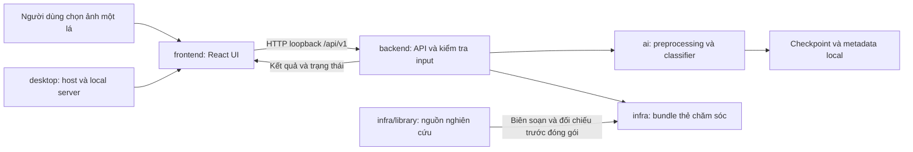

# Kiến trúc offline, chăm sóc và kiểm chứng

## 1. Stack đề xuất

React + TypeScript + Vite/CSS global cho frontend; FastAPI cho API Python; PyTorch/torchvision cho inference; pywebview/WebView2 cho cửa sổ Windows; PyInstaller dạng onedir cho gói đầu tiên. Các dependency này chưa được cài cho app trong lượt lập kế hoạch.

Lý do chọn: giữ UI web theo quy tắc dự án và dùng lại Python ML trong desktop. Không phải học thêm Rust hoặc vận hành Node runtime để phục vụ bản phát hành. FastAPI cung cấp schema/validation; pywebview mở UI web trong cửa sổ native. Xem [pywebview architecture](https://pywebview.flowrl.com/guide/architecture) và [đóng gói](https://pywebview.flowrl.com/guide/freezing).

Thử đóng gói nhỏ ở tuần 1. Nếu pywebview/WebView2 không chạy được trên máy đích sau tối đa một buổi sửa, ghi lỗi và chọn lại host; Electron là phương án có thể giữ nguyên UI/API nhưng tăng chi phí runtime/đóng gói. Chưa tự đổi framework hoặc cài cả hai để “dự phòng”.

## 2. Ranh giới thư mục

| Thư mục | Trách nhiệm | Không đặt ở đây |
| --- | --- | --- |
| `infra/` | Raw dataset, vault, manifest/crop dẫn xuất, bundle tri thức đã đối chiếu | Code train/API/UI |
| `ai/` | Train/evaluate, model factory, preprocessing, inference, model artifacts và tests ML | API route hoặc component UI |
| `backend/` | Endpoint, request/response schema, validation, gọi inference và đọc thẻ chăm sóc | JSX/CSS/HTML hoặc static UI server |
| `frontend/` | React UI, trạng thái tương tác, gọi API qua client có kiểu | Server endpoint, model inference hoặc business rule chăm sóc |
| `desktop/` | Launcher, cửa sổ, vòng đời server, composition `/api` + frontend build, đường dẫn asset, đóng gói | UI source hoặc thuật toán phân loại riêng |
| `docs/` | Kế hoạch, audit dữ liệu, protocol, kết quả, model card, hướng dẫn, báo cáo | Raw image/checkpoint nặng |

`desktop/` là nơi ghép các thành phần: mount API từ `backend/` dưới `/api/v1`, serve asset build từ `frontend/dist/` ở cùng origin. Việc phục vụ asset không chuyển UI source vào backend. Browser khi phát triển có thể dùng Vite proxy đến API; bản offline không chạy Vite dev server.

Ảnh không rời máy. Internet chỉ cần lúc phát triển để lấy dependency/weights/tài liệu; runtime không có cloud API, CDN, remote font hoặc tự tải weights.

## 3. Contract tối thiểu

Các tên dưới đây là thiết kế dự kiến, chưa phải API đã tồn tại:

| API | Đầu vào | Đầu ra/hành vi |
| --- | --- | --- |
| `GET /api/v1/health` | Token phiên | `ready`, `model_version`, `knowledge_version`, lý do chưa sẵn sàng |
| `POST /api/v1/predict` | Một JPEG/PNG multipart, token phiên | `status`, top-k, class_id được chọn hoặc null, score, warnings, model/knowledge version, care_card_id hoặc null |
| `GET /api/v1/care/{class_id}` | ID trong allowlist | Thẻ nguồn tương ứng; ID sai trả 404, không tìm file theo path tùy ý |

Prediction `status` chỉ gồm `ok` hoặc `uncertain` và trả HTTP 200; `invalid_input`, `model_unavailable` và lỗi request dùng HTTP lỗi cùng error schema riêng. Tên field/code cụ thể lấy từ contract coding, không tự đặt ở từng module. Top-k là các lớp khả dĩ, không phải nhiều bệnh được xác nhận đồng thời. Khi `uncertain`, app ưu tiên yêu cầu ảnh rõ hơn và không mở hướng dẫn xử lý đặc hiệu như đã chẩn đoán chắc chắn. Người dùng vẫn có thể tra thẻ như tài liệu tham khảo nếu được gắn nhãn rõ.

Quy tắc tương thích bundle, vòng đời request và mở rộng nằm trong [hợp đồng module](hop-dong-va-mo-rong.md); áp dụng cùng phần kiến trúc này.

Model metadata tối thiểu: architecture, state-dict hash, class-index map, preprocessing, weights provenance, data/split version, training config, supported scope và threshold nếu có. Sai checksum, K hoặc class map thì fail closed; không đoán lại thứ tự thư mục lúc runtime.

Mỗi lượt chỉ một inference; một worker/model instance để tránh nhân RAM. Load một lần, dùng eval và inference mode; inference chạy ngoài UI thread. Request tiếp theo khi bận trả trạng thái rõ. Đóng cửa sổ phải dừng server, giải phóng model và file tạm; không để tiến trình mồ côi.

## 4. Bảo vệ API cục bộ và tài nguyên

- Bind `127.0.0.1`, chọn port khả dụng và kiểm readiness trước mở cửa sổ; không bind `0.0.0.0`.
- Token ngẫu nhiên mỗi phiên, kiểm ở API; dùng cơ chế token/bridge có sẵn của host khi phù hợp. Không hardcode token vào build hoặc log. CORS không thay authentication/CSRF.
- Chỉ chấp nhận origin/Host dự kiến; chặn trang ngoài gọi API; không expose Python filesystem/shell qua bridge. Link nguồn không được điều hướng cửa sổ có đặc quyền sang web ngoài.
- Giới hạn đề xuất: 10 MB upload, 20 megapixel sau decode, JPEG/PNG; kiểm định dạng thật, không chỉ extension/MIME. Từ chối ảnh nén gây quá tải, SVG/GIF hoặc input không hỗ trợ.
- Không nhận path tùy ý từ client để đọc ổ đĩa. Không log ảnh/base64/token. Không tự lưu ảnh; nếu cần file tạm phải giới hạn vị trí và xóa sau request/đóng app.
- Chỉ nạp checkpoint do dự án đóng gói; không cung cấp nút mở `.pth` tùy ý. Giữ `weights_only=True` khi phù hợp, kiểm hash và schema.

[pywebview security](https://pywebview.flowrl.com/guide/security) nêu rủi ro CSRF với REST API local và token theo phiên. Chi tiết triển khai phải được test khi code, không coi localhost là đủ an toàn.

## 5. Chăm sóc offline không cần LLM

Classifier chỉ học nhãn ảnh. Nội dung chăm sóc là bộ thẻ theo `class_id`, đóng gói JSON đã đối chiếu nguồn. Không train lời khuyên vào EfficientNet hoặc ResNet50, không cần vector database, chatbot hay mô hình ngôn ngữ chạy trên GPU 4 GB.

Mỗi thẻ có: tên Việt/Anh, nhóm bệnh/dịch hại/trạng thái, triệu chứng gợi ý, nguyên nhân dễ nhầm, việc quan sát thêm, biện pháp canh tác/IPM có nguồn, điều kiện áp dụng, điều không nên suy từ ảnh, nguồn URL/mục hoặc trang, ngày kiểm, reviewer, phiên bản và tình trạng bằng chứng.

Luồng biên soạn trong tuần 5:

1. Map mỗi class tới hồ sơ đã có trong `infra/library/02-Nguon/`; đọc clip gốc liên quan, không chỉ tiêu đề.
2. Mỗi thẻ ưu tiên một nguồn chính từ trường/viện/cơ quan BVTV và một nguồn độc lập để đối chiếu khi có. Không dùng hai bản mirror của cùng bài như hai nguồn.
3. AI soạn bản tóm tắt tiếng Việt; bạn kiểm từng khuyến nghị, điều kiện và phủ định bằng nguồn. Ghi rõ đây là đối chiếu tài liệu bởi chủ dự án, không là chuyên gia kiểm định.
4. Kiểm quyền tái sử dụng nội dung tóm tắt/ảnh trước đóng gói; ưu tiên tự diễn đạt có dẫn nguồn, không sao chép toàn bài/bảng/ảnh. Thiếu quyền hoặc căn cứ thì chọn nguồn khác hoặc ghi thiếu thông tin.
5. Tạo danh sách cho phép các thẻ đủ điều kiện hiển thị theo chính sách của app mới. Giữ nguồn nháp và `rag_ready:false` trong vault. Không lấy raw draft xuất trực tiếp và không đổi gate TomatoAI cũ.
6. Test mọi class_id có đúng một thẻ, các nguồn resolve được, không có liều thuốc tự sinh, không lấy thẻ bệnh khác làm fallback khi thiếu mapping.

Trạng thái mới đề xuất cho bản tổng hợp: `review_status: source_checked`, `reviewer_role: project_author`, `expert_verified: false`, quyền và phạm vi hiển thị được ghi riêng. Trạng thái này chỉ mô tả đối chiếu nguồn, không thay một trường chuyên gia hiện hữu hoặc tự cấp quyền xuất dữ liệu. Nếu tái sử dụng pipeline TomatoAI cũ, phải đọc contract và dùng đúng gate của pipeline đó trước tích hợp.

Trong app, thẻ ghi “Thông tin tham khảo đã đối chiếu tài liệu; chưa thẩm định chuyên môn tại địa phương”. Không bắt người dùng tìm chuyên gia mới được dùng demo. Khi bằng chứng thiếu, app nêu điều chưa biết và việc cần quan sát; không tự hoàn thiện hướng dẫn bằng suy đoán.

Nguồn theo lớp cần rà từ vault:

| Lớp dự kiến | Điểm bắt đầu tìm nguồn | Điều cần phân biệt |
| --- | --- | --- |
| Bacterial spot | UC-005, INT-008 | Không đồng nhất bacterial speck/canker |
| Early blight | UC-002 | Dễ nhầm nhóm đốm lá khác |
| Late blight | UC-003, nguồn Việt Nam về mốc sương | Không suy bệnh rễ/quả từ một ảnh lá |
| Leaf mold | NC-004, nguồn chuyên đề nếu cần | Bối cảnh nhà kính, khác các loại mốc khác |
| Septoria | NC-001, INT-015 | Giữ tên tác nhân/triệu chứng theo nguồn |
| Spider mites | INT-020 | Nhện hai chấm khác tomato russet mite; không dùng UC-012 để thay tên loài |
| Yellow leaf curl | UC-007, INT-003 | Ảnh triệu chứng không xác nhận virus bằng xét nghiệm |
| Healthy | Nguồn chăm sóc nền như INT-019 | Không suy nhu cầu phân/tưới chính xác từ ảnh |

Đây là danh sách ứng viên từ sổ nguồn, chưa phải tám thẻ đã hoàn thành. Kiểm file tồn tại/nội dung và đối chiếu trước dùng. Thuốc, liều, PHI/REI và đăng ký nước ngoài không thành hướng dẫn Việt Nam; bản MVP ưu tiên chăm sóc canh tác/IPM có điều kiện áp dụng. Xác nhận chuyên gia độc lập là cải tiến sau đồ án, không nằm trên đường găng.

## 6. Đóng gói và kiểm thử

Tạo môi trường build CPU riêng, không gom cả môi trường train CUDA vào app. Gói onedir gồm executable, Python dependency cần thiết, frontend build, checkpoint đã chọn, metadata, thẻ chăm sóc và license notices. Không kèm dataset hoặc toàn vault. PyInstaller không làm nội dung có quyền chưa rõ trở thành được phép phát hành.

WebView2 cần có trên máy đích. Kiểm runtime và kèm bộ cài offline phù hợp khi cần theo [Microsoft distribution](https://learn.microsoft.com/en-us/microsoft-edge/webview2/concepts/distribution). Không dựa vào bootstrapper tải mạng trong buổi bảo vệ. Đo kích thước gói thực; PyTorch CPU vẫn có thể tạo gói lớn.

| Tầng | Bằng chứng cần có |
| --- | --- |
| Data/ML | Không giao nhóm, crop đúng với fixture biết trước, label map round-trip, reload dự đoán khớp, loss hữu hạn |
| API | JPEG/PNG hợp lệ, fake file, oversized, sai token/origin, class không có, model lỗi, busy và mapping thẻ |
| Frontend | Chọn ảnh, preview, loading, thành công, bất định, lỗi và mở thẻ/nguồn; thao tác bàn phím |
| Desktop | Khởi động, port bị chiếm, đường dẫn tiếng Việt, model thiếu, đóng/mở lại không còn server mồ côi |
| Offline | Chạy binary từ đường dẫn ngoài repo, không Python/CUDA, ngắt mạng, tài nguyên/thẻ có sẵn; ảnh không được gửi ra ngoài |

Theo AGENTS, khi đã sửa code phải dùng skill `e2e` và runner hiện có để kiểm flow ảnh–kết quả–thẻ. Checkout này chưa có `e2e.config.ts`, package frontend hoặc project skill; kiểm global skill/cấu hình thực khi triển khai. Nếu dùng `agent.act`, kiểm credential mà không in secret; thiếu credential thì báo blocker và dùng kiểm thử Playwright xác định được làm bằng chứng bổ sung, không nhận đã pass runner chưa chạy.

Browser E2E kiểm UI/API được, nhưng chưa chứng minh WebView2 và executable chạy được. Cần smoke test native bằng computer-use hoặc thao tác có checklist trên binary. Test dùng fixture có kết quả ổn định để kiểm luồng; đánh giá độ chính xác model bằng test set riêng, không assertion tùy hứng rằng mọi ảnh đều phải đoán đúng.

Khi làm UI: đọc Impeccable global nếu bản project vẫn thiếu, chọn nhánh UI 2D với `shape/layout/clarify/harden` theo phạm vi. Chưa thiết kế mỹ thuật hoặc sửa UI trong lượt này. Báo cáo kiểm thử ở `docs/verification/`, gồm lệnh, môi trường, kết quả, trace/screenshot khi có và phần chưa kiểm.
